# Aerial Traffic Intelligence

**Road-user trajectories and traffic insight from drone video and its onboard telemetry — no annotations, no ground control points, no survey.**

Two 4K clips from a hovering DJI Matrice 3D over an arterial road in Pune are processed end to end into map-native traffic data. Every road user is detected, tracked through occlusion, classified, projected onto the ground plane using only the drone's own SRT telemetry, and bound to a named carriageway and lane in OpenStreetMap.

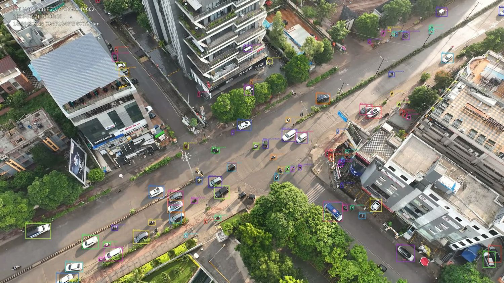

*Detection and tracking at t = 28 s. Each box carries a stable track ID and a taxonomy class. Box colour is **per identity**, not per class, so an identity swap shows up as a colour change.*

---

## What it produces

| | |
|---|---|
| **407,483** | detections across the four fully processed runs |
| **4,529** | tracked road-user identities |
| **1.15–1.87 m** | median distance from a projected vehicle to the nearest OSM carriageway centreline |
| **77–94 %** | of projected points land within one 3.5 m lane |
| **294** | drivable OSM links in the matching network |
| **84 %** | of map-bound tracks also assigned a lane |

The central technical claim is the spatial one: **the ground projection is derived from telemetry alone** — GPS position, relative altitude and gimbal attitude — then refined against road geometry. No manual registration anywhere in the chain.

---

## Contents

- [The data](#the-data)
- [Architecture](#architecture)
- [Level 1 — detection and identity](#level-1--detection-and-identity)
- [Level 2 — classification and kinematics](#level-2--classification-and-kinematics)
- [Level 3 — aggregate insight](#level-3--aggregate-insight)
- [Level 4 — spatial grounding](#level-4--spatial-grounding)
- [The dashboard](#the-dashboard)
- [What is validated, and how](#what-is-validated-and-how)
- [Known defects and limitations](#known-defects-and-limitations)
- [Quickstart](#quickstart)
- [Repository layout](#repository-layout)

---

## The data

Both clips come from the same aircraft on the same evening, from the same hover point. The only meaningful difference is **gimbal pitch**, and that single parameter changes the problem completely.

| | Intersection | Multiroad |
|---|---|---|
| Gimbal pitch | **−63.1°** (near-nadir) | **−18.5°** (shallow oblique) |
| Gimbal yaw | −126.4° | −83.6° |
| SRT telemetry frames | 11,971 | 9,140 |
| Relative altitude | 70.44 – 70.50 m | 70.44 – 70.50 m |
| Sensor / rate | 3840 × 2160 @ 29.97 fps | 3840 × 2160 @ 29.97 fps |
| Station-keeping drift | < 0.2 m | < 0.2 m |

At −18.5° the optical axis meets the ground about 211 m out, where range changes by roughly **12 m per degree of pitch**. Gimbal pitch is *reported* to 0.1° but is not *accurate* to it — which is why the projection has to be refined rather than trusted (see [Level 4](#level-4--spatial-grounding)).

The aircraft holds station to within about 0.2 m over the whole recording, so a single camera pose describes the entire clip and the projection can be fitted once rather than per frame.

**Site:** 18.566225 °N, 73.771845 °E — Gopal Hari Deshmukh Marg, Baner/Balewadi, Pune, India.

---

## Architecture

Eight stages, each a standalone module that writes a file the next one reads — so any stage can be re-run in isolation and its output inspected. Heavy inference (A–B) runs on Kaggle GPUs; everything downstream runs locally in seconds.

| | Stage | What it does | Module |
|---|---|---|---|
| **A** | Tiled detection | VisDrone-pretrained YOLO11s under SAHI slicing — 768 px tiles, 0.2 overlap, conf 0.35. At 70 m AGL a motorcycle is a handful of pixels in a 4K frame; whole-frame inference misses them entirely. | `kaggle/level4_90s/` |
| **B** | Multi-object tracking | BoT-SORT with OSNet re-identification (`boxmot`), against a ByteTrack baseline. ReID carries identity through tree canopy and building shadow. | `kaggle/` |
| **C** | Taxonomy mapping | VisDrone's 11 native classes → the six required road-user classes plus *other*. | `pipeline/taxonomy.py` |
| **D** | Ground projection | Pinhole camera from the SRT's 35 mm-equivalent focal length, relative altitude and gimbal attitude → East/North metres in a local ENU frame. | `pipeline/geo_reference_telemetry.py`, `geodesy.py` |
| **E** | Projection refinement | Coarse-to-fine fit of pitch, yaw, altitude scale and a residual GPS shift against the road network. | `pipeline/refine_projection.py` |
| **F** | Kinematics | Savitzky–Golay smoothing before differentiation; separate windows for speed (9 frames) and acceleration (21). | `pipeline/kinematics.py`, `level2_enrich.py` |
| **G** | Aggregation | Counts, turning movements, O–D matrix, speed profile, corridors and lanes, queues, flow–density. | `pipeline/level3_aggregate.py` |
| **H** | Map matching and export | Link, direction and lane binding with heading agreement and a one-way legality penalty; GeoJSON + dashboard bundle. | `pipeline/map_match.py`, `map_export.py` |

---

## Level 1 — detection and identity

Detection quality is the floor everything else stands on, so it was measured rather than assumed. A generic COCO-pretrained YOLO missed pedestrians and motorcycles **entirely** on a test crop from this footage; the VisDrone-pretrained weights found 93 objects across all required classes on the same crop. That comparison decided the detector.

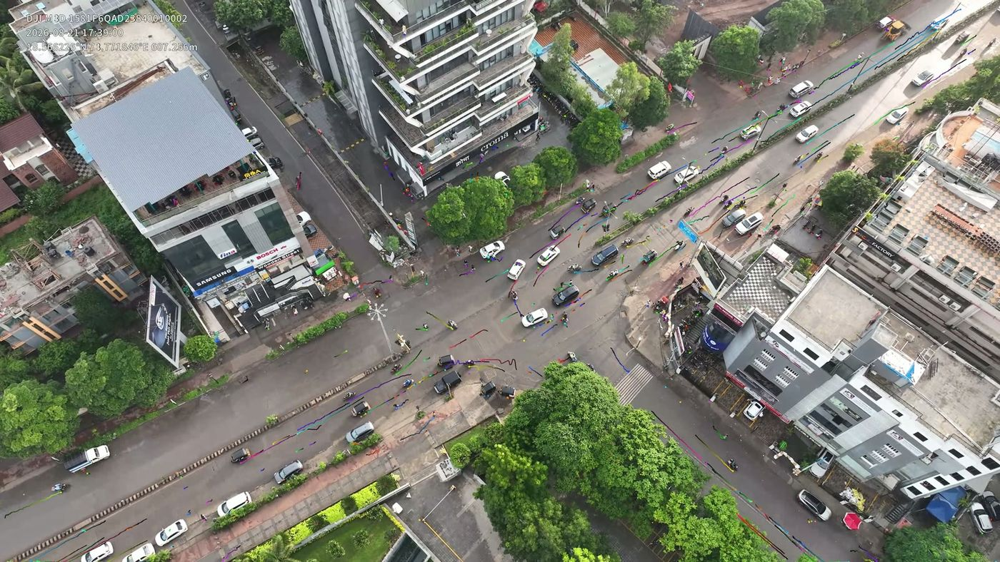

*Per-track history rendered over the source frame. Continuous, non-crossing trails are the visual signature of stable identity assignment.*

### Tracker choice, measured

Given an identical detector and clip, a tracker that loses and re-acquires identities invents new track IDs — so the count of unique IDs is an inverse proxy for identity stability. On the intersection 10-second clip, ByteTrack produced **1,081** identities where BoT-SORT with ReID produced **362**. Three times fewer, for the same traffic.

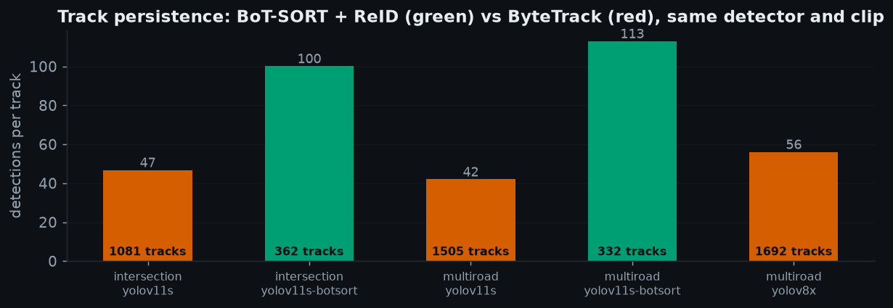

| Run | Frames | Detections | Track IDs | Tracker |
|---|---:|---:|---:|---|
| intersection 10 s | 302 | 36,273 | **362** | BoT-SORT + ReID |
| intersection 10 s | 302 | 50,628 | 1,081 | ByteTrack |
| intersection 90 s | 900 | 78,794 | 1,187 | BoT-SORT + ReID |
| multiroad 10 s | 302 | 37,526 | **332** | BoT-SORT + ReID |
| multiroad 10 s | 302 | 63,264 | 1,505 | ByteTrack |
| multiroad 10 s | 300 | 94,963 | 1,692 | ByteTrack (YOLOv8x) |
| multiroad 90 s | 900 | 115,833 | 1,648 | BoT-SORT + ReID |
| multiroad 90 s | 2,698 | 623,200 | 12,338 | ByteTrack |

> **Design decision — 10 fps processing, 30 fps playback.**
> The 90-second runs process every third frame at an effective 10 fps, because a real deployment would not run a tiled 4K detector at full rate. Each record stores its *original* frame index and timestamp, so analytics stay in lockstep with 29.97 fps playback rather than forcing the video down to 10 fps.

---

## Level 2 — classification and kinematics

Two parts of this level deserve candour rather than a confident label.

**LGV versus HGV is not a detector output.** No public pretrained detector distinguishes a light goods vehicle from a heavy one — that is a traffic-survey distinction, not a VisDrone class. The pipeline keeps VisDrone's *van* and *truck* as `LGV_candidate` and `HGV_candidate`, named so downstream consumers cannot mistake them for a settled classification.

**Licence-plate recognition was dropped, not attempted and hidden.** At 70 m altitude over a 4K sensor a plate occupies well under one pixel of legible glyph height. No model choice recovers information the optics never captured.

| VisDrone class | Mapped to | Note |
|---|---|---|
| `car` | car | — |
| `van` | LGV_candidate | not a confirmed LGV |
| `truck` | HGV_candidate | not a confirmed HGV |
| `bus` | bus | — |
| `motor` | motorcycle | — |
| `pedestrian`, `people` | pedestrian | "people" = dense group |
| `tricycle`, `awning-tricycle` | other | auto-rickshaw; absent from the brief |
| `bicycle`, `others` | other | — |

Because stage D puts every detection in metres, speed is a physical measurement rather than pixels per frame.

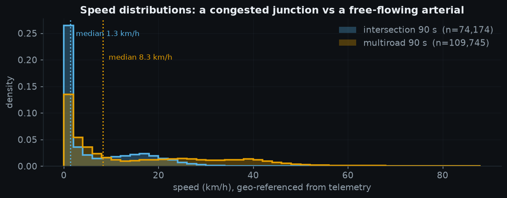

*The intersection piles up at a standstill while multiroad spreads across a running range. Samples above 120 km/h are discarded as identity-switch artefacts — that rejection rate is itself a tracking-quality signal, running at 0.00–0.24 % on the 90-second BoT-SORT runs against 1.91–2.42 % on the 10-second ones.*

---

## Level 3 — aggregate insight

All nine items named in the brief are produced. The design constraint throughout: an aggregate must be defensible as a traffic-engineering quantity, not merely computable. Prevailing speed is reported as the **85th percentile**, the standard measure, and lanes are counted per directional corridor rather than scene-wide.

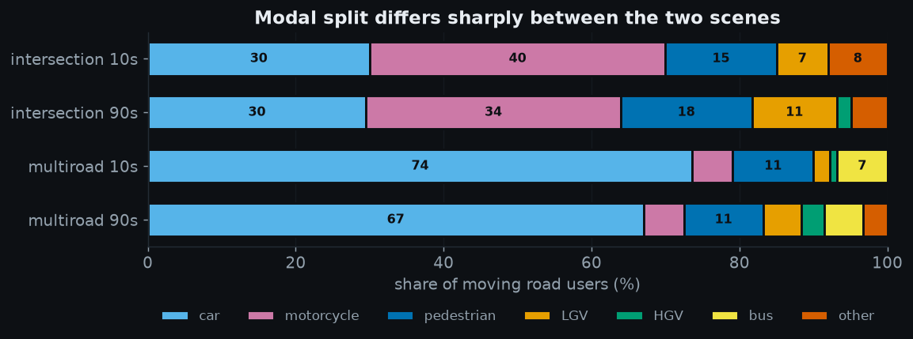

*The two sites are genuinely different populations. At the intersection, motorcycles are the single largest mode; on the multiroad arterial, cars dominate and buses appear in numbers absent from the junction.*

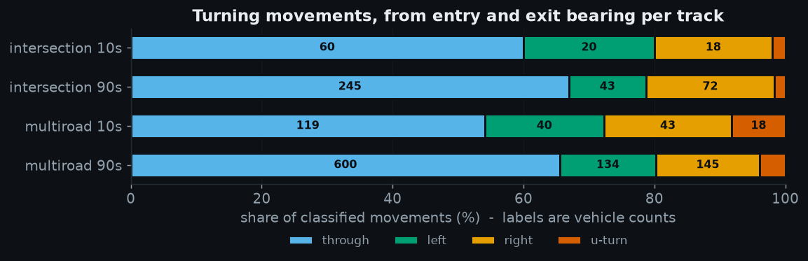

*Classified from each track's entry and exit bearing. The multiroad runs carry a visibly higher U-turn share, consistent with a divided carriageway where reaching the opposite side requires one.*

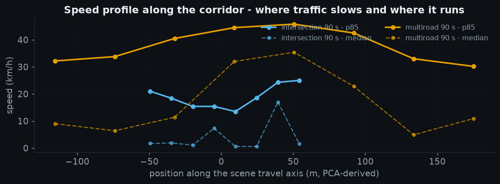

*Position is measured along a travel axis derived by **principal component analysis of vehicle displacement** — the scene's own road direction, not an image axis, so the method needs no per-scene configuration. The gap between the p85 and median lines is the congestion signal.*

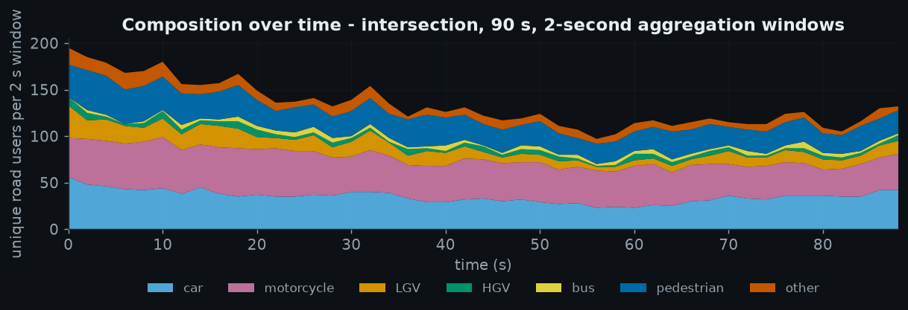

*Roughly 140–190 unique road users are present in any 2-second window, with a class mix that stays broadly stable across the 90 seconds.*

> **A bug worth recording — corridors before lanes.**
> An early version clustered lateral offset from one global travel axis and reported "16 lanes" on the multiroad scene. A wide aerial shot contains several *separate roads*, and a single global axis conflates them. Grouping by direction of travel first, then clustering lateral offset *within* each corridor, produced 8 corridors and 11 lanes at 10 seconds — which matches the site.

---

## Level 4 — spatial grounding

The chain is: pixel → ground plane via telemetry → local ENU metres → WGS84 → matched OSM link, direction and lane.

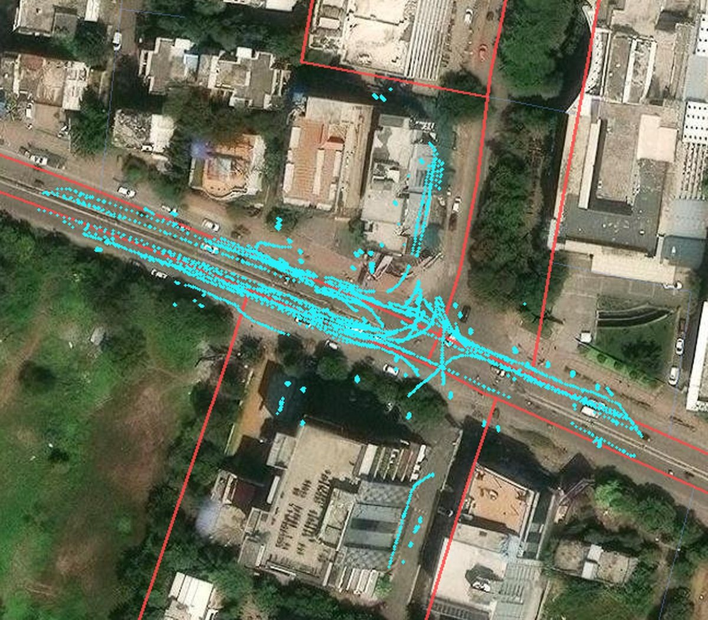

*Cyan points are vehicle ground positions from the telemetry projection; red lines are the OpenStreetMap carriageways that carried observed traffic. Rendered offline at native tile resolution (0.28 m/px) — a metre-level claim cannot be judged at dashboard zoom. The trajectories trace the carriageway, the side road, and the turning paths through the junction.*

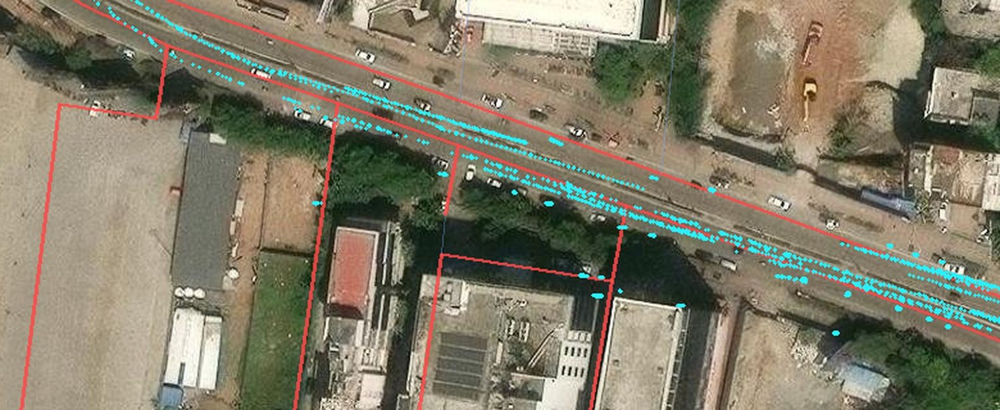

*Two parallel OSM ways about 15 m apart carry opposing traffic; points ride both. Median absolute offset to the nearest centreline here is 2.29 m — inside the band a correctly placed vehicle occupies, since OSM stores one centreline per carriageway rather than one line per lane.*

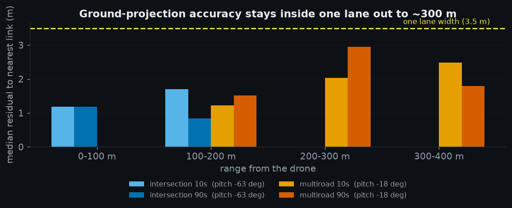

| Run | Pitch | Median | p90 | Within lane | Fitted Δpitch |
|---|---:|---:|---:|---:|---:|
| intersection 10 s | −63.1° | 1.27 m | 9.13 m | 83 % | +1.6° |
| intersection 90 s | −63.1° | **1.15 m** | 3.20 m | **94 %** | +2.9° |
| multiroad 10 s | −18.5° | 1.44 m | 4.10 m | 82 % | +0.5° |
| multiroad 90 s | −18.5° | 1.87 m | 4.35 m | 77 % | +0.2° |

### Separating the two carriageways

Geometry alone cannot decide which half of a divided road a vehicle is on — the two centrelines are only ~15 m apart, and a lateral error of one lane simply reassigns the point. **Topology settles it.** The two ways carry `oneway=yes` in opposing directions, 179.8° apart, so the matcher charges a 40 m-equivalent penalty for travelling against the arrow. Direction of travel, not proximity, is what separates them.

| Map-matching parameter | Value | Role |
|---|---:|---|
| Maximum match distance | 25.0 m | beyond this, no link explains the point |
| Heading weight | 0.12 m/deg | penalty per degree of heading disagreement |
| Wrong-way penalty | 40.0 m | dominates unless distance strongly disagrees |
| Link-switch penalty | 6.0 m | discourages frame-to-frame flicker |
| Minimum speed for heading | 3.0 km/h | below this a heading is noise |
| Lane width | 3.5 m | lateral offset → lane index |

### Per-lane metrics on real geometry

Two speeds are reported per lane, and the gap between them is the point: the median over all vehicles includes parked ones, while the running speed counts only movers.

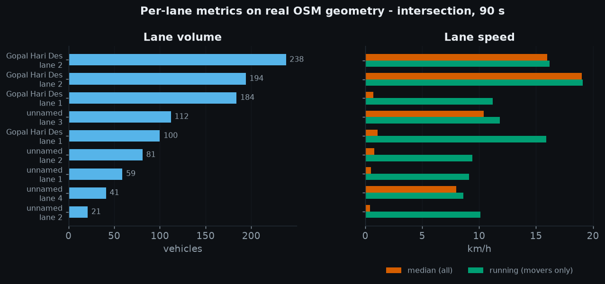

*Three lanes show a median under 1.1 km/h alongside a running speed of 11–16 km/h — kerbside lanes with substantial parking. Quoting either number alone would mislead.*

> **A bug worth recording — queue extents.**
> Queue length was originally the span between the furthest-apart stopped vehicles on a link, with no contiguity test. That reported 310–482 m "queues" from 4–15 vehicles — about 32 m of queue per vehicle, which is mostly empty road. Splitting stopped vehicles into contiguous runs (a gap over 25 m ends the queue), and excluding pedestrians and never-moving parked vehicles, brought extents to 8–77 m at about **8.6 m per queued vehicle**. That is textbook jam spacing, and it was not tuned for — it fell out of the fix, which is what makes it good evidence.

---

## The dashboard

Plain JavaScript and Canvas — no framework, no build step, no runtime network calls. Map tiles are cached locally, so the whole thing runs offline.

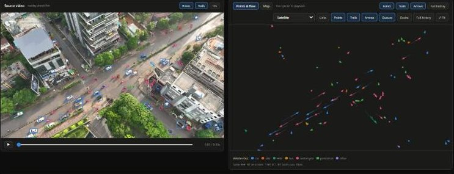

*Two synchronised panels: source video with a live overlay on the left, an abstract points-and-flow canvas on the right. Arrowheads carry real-world heading.*

| | |
|---|---|
| 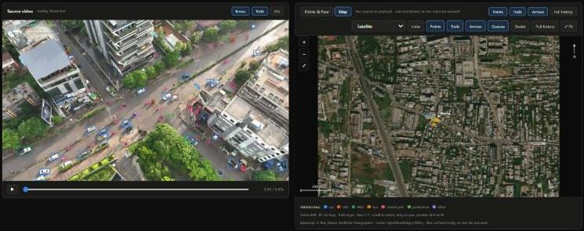 | 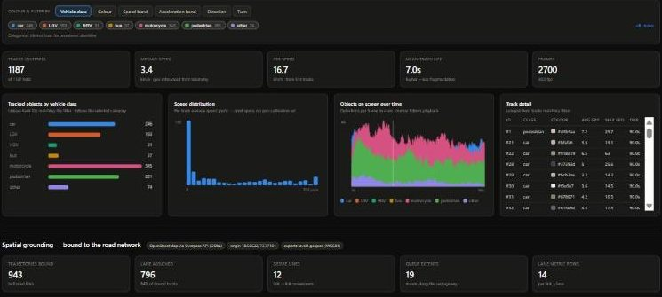 |
| **Map view** — the same trajectories on cached satellite tiles with OSM road data, pannable and zoomable, updating as the video plays. | **Analytics deck** — 943 trajectories bound to 6 road links, 796 lane-assigned, 12 desire lines, 19 queue extents, 14 lane-metric rows. |

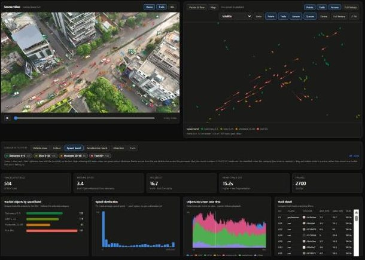

*One control selects the dimension that both **filters** and **colours** every view at once — here speed band, on a green-to-red ramp built in OKLCH with monotonic lightness so it survives colour-vision deficiency and greyscale printing. Selecting the moving bands drops 1,187 tracks to 514 and lifts mean track life from 7.0 s to 15.2 s, because short-lived fragments are mostly stationary detections.*

Two performance problems were found by measurement rather than guesswork. The static server was single-threaded, so a playing video's continuous Range requests queued behind data and tile fetches; a threading server let six parallel requests, including two 4 MB video ranges, complete in 1,247 ms. Separately the canvas was issuing ~1,400 draw calls per frame (~84,000/s) because each trail segment set its own stroke state; batching all geometry sharing a colour into one `Path2D` cut that to ~21 calls per frame.

---

## What is validated, and how

| Claim | Check | Result |
|---|---|---|
| ENU ↔ WGS84 conversion is correct | Round-trip plus per-latitude metres-per-degree | Exact round-trip; 110,686.9 m/deg lat, 105,561.8 m/deg lon at site |
| Ground projection is geometrically sound | Nadir symmetry, horizon rejection, oblique scale growth, vectorised vs scalar agreement | All pass; ground sampling grows 0.042 → 0.076 m/px across the oblique frame |
| Projection lands vehicles on roads | Median distance to nearest OSM carriageway centreline | 1.15–1.87 m across four runs; 77–94 % within one lane |
| Scale is physically plausible | Ground footprint of 694 tracks vs known vehicle dimensions | Pedestrians measure 0.63 / 0.79 m — correct. Cars read as diagonal, not width |
| Speeds are in real units | Pedestrian p85 speed against walking pace | 4.4–8.0 km/h, consistent with ~5 km/h walking (see caveat) |
| Queue extents are physical | Metres of queue per queued vehicle | ~8.6 m/vehicle, matching jam spacing |
| Carriageways correctly separated | One-way bearing difference between paired OSM ways | 110.9° vs 290.7° — 179.8° apart |
| Tracking is stable | Implausible-speed rejection rate as identity-switch proxy | 0.00–0.24 % on the 90 s BoT-SORT runs |

> **Caveat on the pedestrian check.** The pedestrian *median* speed is 2.0–3.1 km/h and the *p85* is 4.4–8.0 km/h. The median is low because many detected pedestrians are standing or loitering, not walking. The p85 brackets walking pace, so the check supports the scale being right — but it is a consistency check, not a decisive confirmation.

---

## Known defects and limitations

Named precisely, because a number that looks like a measurement and is not is worse than a missing one.

### Defects in current output

1. **Occupancy is structurally broken.** `occupancy_pct` reads exactly `100.0` in every interval of every run. The formula multiplies density by an assumed 5 m vehicle length without dividing by lane count, so with densities of 24.6–74 vehicles per 100 m of *corridor* it always clips to the ceiling. It is a constant, not a measurement. **Do not use it.**

2. **Hourly flow is a two-second extrapolation.** `flow_veh_per_h` multiplies arrivals in a 2-second window by 1,800. Values range from 0 to 192,600 veh/h, against a real urban arterial capacity of roughly 1,500–2,500 veh/h per lane. The *shape* of the flow–density relation is informative; the absolute hourly number is not.

3. **The multiroad projection refit does not reproduce.** The stored fit records a 1.44 m median over 684 points; the same code on current detections fits 2,318 points and reaches ~4.2 m, and widening the parameter grid does not recover it. The likely reading is that 1.44 m was measured over a smaller, easier subset and therefore *overstates* accuracy.

4. **The refit objective cannot see cross-road error.** It minimises median distance to the *nearest* link, and on a divided road a sideways shift of one lane just reassigns points to the other carriageway. The cost surface is nearly flat across the road. A direction-aware residual exists as a diagnostic; using it to drive the search was tried, measured head to head, and lost (3.76 m plain vs 4.48 m directional), so it was not shipped.

5. **Lane counts over-segment on the long multiroad run** — 40 lanes across 6 corridors at 90 s, against 11 lanes at 10 s. The minimum-membership threshold needs to scale with sample size.

6. **A residual lateral bias remains on multiroad.** Signed offset to the nearest centreline has a median of −1.12 m, reaching −4.62 m in the 200–250 m band. Not monotonic in range, so not a simple yaw error. Unfixed.

### Scope limitations

- **Two runs have no geo data** — multiroad 10 s (YOLOv8x) and multiroad 90 s (ByteTrack) were never enriched, so Levels 2–4 are unavailable for them.
- **Flat-earth assumption.** The projection assumes a planar ground. The site is essentially flat, but a flyover or graded slope would introduce error the model cannot represent.
- **Lane indices are observations, not survey.** A lane is where traffic actually ran, derived from lateral offset.
- **Single site, single session.** One evening at one location in Pune. Nothing tested against another site, altitude or camera.
- **No annotation ground truth.** There are no labels for this footage, so detection and tracking accuracy are argued from internal consistency and physical plausibility rather than measured against a reference.

---

## Quickstart

Stages D–H run locally in seconds. Stages A–B need a GPU and are run as Kaggle notebooks (`kaggle/`).

```bash
python -m venv .venv && .venv/Scripts/activate      # Windows; use bin/activate elsewhere
pip install -r requirements.txt

# stage D-F: telemetry projection, refinement, kinematics
python -m pipeline.refine_projection videos/samples/<scene>/<dur>/<model>
python -m pipeline.level2_enrich

# stage G: aggregate insight for every processed run
python -m pipeline.level3_aggregate

# stage H: bind to the road network and export map layers
python -m pipeline.map_match  videos/samples/<scene>/<dur>/<model>
python -m pipeline.map_export videos/samples/<scene>/<dur>/<model>

# basemap tiles (cached once, then fully offline)
python -m pipeline.fetch_tiles --zoom 17 18 19 20

# build the dashboard bundle and serve it
python web/export_data.py
python web/serve.py 8600        # -> http://localhost:8600
```

Most pipeline modules are runnable directly and execute their own self-tests:

```bash
python -m pipeline.geodesy                 # ENU <-> WGS84 round-trip
python -m pipeline.geo_reference_telemetry # nadir symmetry, horizon rejection, scale growth
python -m pipeline.validate_scale          # ground footprint vs known vehicle sizes
```

---

## Repository layout

```
pipeline/          17 modules, 2,909 lines - the processing chain (stages C-H)
  geodesy.py             ENU <-> WGS84 with per-latitude ellipsoidal scaling
  geo_reference_telemetry.py  pinhole ground projection from SRT telemetry
  refine_projection.py   camera-parameter fitting against road geometry
  register_to_map.py     rigid registration and residual metrics
  road_network.py        Overpass fetch and cache
  map_match.py           link, direction and lane binding
  map_export.py          GeoJSON, lane metrics, desire lines, queues
  level2_enrich.py       class, colour, kinematics in real units
  level3_aggregate.py    all nine aggregate-insight items
  kinematics.py          Savitzky-Golay speed and acceleration
  taxonomy.py            VisDrone -> required class mapping
  srt_parser.py          DJI telemetry parsing
  fetch_tiles.py         offline basemap cache
  validate_scale.py      footprint vs known vehicle size

web/               2,821 lines - dependency-free browser dashboard
  app.js                 rendering and interaction (2,000 lines)
  index.html             layout and controls
  export_data.py         dashboard data bundle
  serve.py               Range-capable static server

kaggle/            GPU notebooks for detection and tracking (stages A-B)
docs/figures/      every figure in this README, generated from real output
data_cache/        cached OpenStreetMap network for the study site
```

Large or regenerable artefacts are deliberately not committed: source video, transcoded clips, exported dashboard JSON, cached basemap tiles, Kaggle run outputs and model weights. Every one is reproducible with the commands above.

---

## Attribution

- Road data © OpenStreetMap contributors, via the Overpass API ([ODbL](https://www.openstreetmap.org/copyright)).
- Basemap imagery © Esri, Maxar, Earthstar Geographics — cached locally for offline rendering, not redistributed in this repository.
- Detector weights: [`dronefreak/visdrone-yolov11s`](https://huggingface.co/dronefreak) (VisDrone-pretrained YOLO11s).
- Tracking: [`boxmot`](https://github.com/mikel-brostrom/boxmot) BoT-SORT with OSNet ReID; [`supervision`](https://github.com/roboflow/supervision) ByteTrack as baseline.
- Tiled inference: [SAHI](https://github.com/obss/sahi).

All figures in this README were generated from this repository's own output. No values are illustrative.
